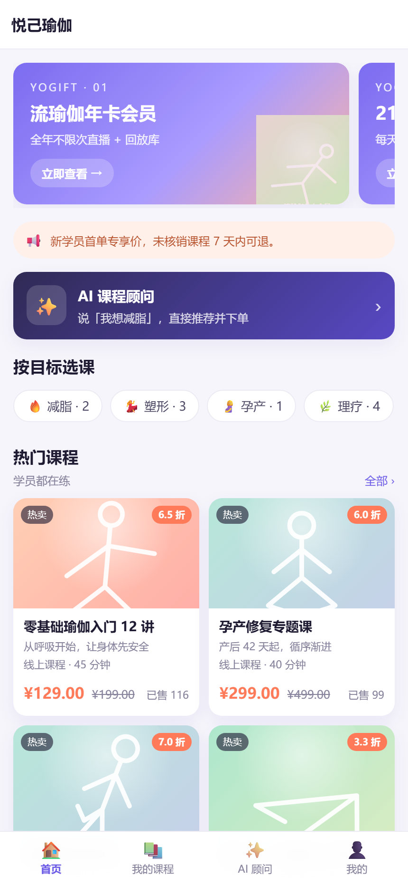
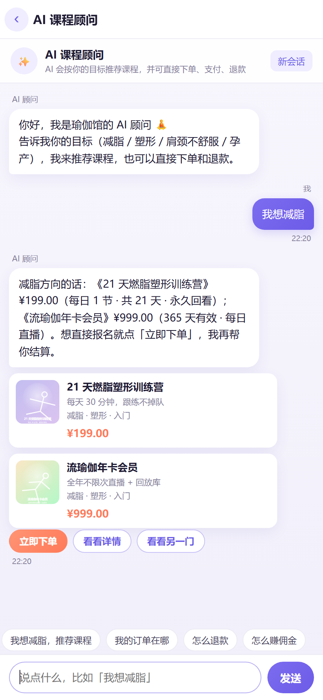

# 瑜伽卖课小程序

微信原生小程序 + H5 预览站 + 零依赖 Node 后端。一套代码覆盖 **商品 / 下单 / 支付 / 退款 / 客服 / 二级分销 / AI 商城** 全链路。

> 设计取向：**不装依赖、不连云、本机就能跑通并验收**。
> 后端只用 Node 内置模块（`node:http` + `node:sqlite` + `node:crypto`），`git clone` 后 `node server/index.js` 即起。

---

## 一、三个需求 → 落地位置

| 需求 | 实现 |
| --- | --- |
| ① 商品、下单、退款、客服等基础功能 | `server/modules/{product,order,payment,refund,entitlement,service}` + `web/`（H5）+ `miniprogram/pages/*` + `web/admin.html` |
| ② 二级分销 | `server/modules/distribution`：邀请绑定、两级佣金（15% / 5%）、冻结期、退款冲正、提现审核 |
| ③ AI 商城：引导下单支付退款 | `server/modules/ai` + `web/#/ai`：意图识别 → 商品卡 → 一键下单 → 收银台 → 支付 → 退款，全程在对话里完成 |

---

## 二、快速开始

```bash
# 环境要求：Node ≥ 22.5（需要内置 node:sqlite），无需 npm install
node server/index.js
```

启动后：

| 入口 | 地址 |
| --- | --- |
| H5 商城（本机验收主通道） | http://127.0.0.1:3100/ |
| AI 商城 | http://127.0.0.1:3100/#/ai |
| 后台管理 | http://127.0.0.1:3100/admin |
| 健康检查 | http://127.0.0.1:3100/api/_health |
| 小程序源码预览 | http://127.0.0.1:3100/mp/ |

**演示账号**

- 用户（H5 页面上有快捷登录按钮）：`dev_demo_a` / `dev_demo_b` / `dev_demo_c`，邀请码 `DEMOA` / `DEMOB` / `DEMOC`，分销链路 `A ← B ← C`。
- 后台：`admin` / `admin123`（首次启动自动创建）。

**常用命令**

```bash
node --watch server/index.js     # 开发热重载
node --test test/                # 单元 + 接口测试
node scripts/smoke.mjs           # 端到端冒烟（下单→支付→佣金→退款→AI 对话）
node scripts/db-reset.mjs        # 重置数据库并灌种子数据
node scripts/check-frontend.mjs  # 前端静态自检（页面齐全/JS 语法/接口路径）
```

环境变量见 `.env.example`（复制成 `.env` 生效，不复制也能跑，全部有默认值）。

---

## 三、技术栈与架构

```
┌──────────────────────────────────────────────────────────┐
│  miniprogram/  微信原生小程序（appid: touristappid）       │
│  web/          H5 商城 + AI 商城 + 后台（无构建，原生 JS） │
└───────────────────────┬──────────────────────────────────┘
                        │  JSON over HTTP（统一 {ok,data} / {ok:false,code,message}）
┌───────────────────────┴──────────────────────────────────┐
│  server/http      router · ctx · validate · auth · static │
│  server/modules   auth product order payment refund       │
│                   entitlement distribution service ai admin│
│  server/utils     money time id jwt crypto svg audit      │
│  server/db.js     node:sqlite（WAL）· 事务 · 设置缓存      │
└───────────────────────┬──────────────────────────────────┘
                        │
              data/app.db（SQLite 单文件）
```

- **金额**：一律整数「分」，展示用 `xxxText`（`"199.00"`）。
- **时间**：一律 ISO-8601 UTC 字符串（字典序即时间序）。
- **鉴权**：自实现 HS256 JWT；用户 `Authorization: Bearer`，后台 `x-admin-token`。
- **支付**：`PAY_PROVIDER=mock`（默认，点一下即支付成功）/ `wxpay`（微信支付 v3 代码路径已实现，需自行配置商户号）。
- **AI**：`AI_PROVIDER=rule`（默认，离线意图引擎，零延迟零成本）/ `llm`（OpenAI 兼容接口，失败自动降级 rule）。

---

## 四、目录结构

```
├── server/
│   ├── index.js            HTTP 入口：路由装配、静态托管、优雅关闭
│   ├── config.js           配置（.env 解析 + 业务默认值）
│   ├── db.js               数据库连接、建表、事务、设置读写
│   ├── seed.js             种子数据（6 门课程、演示账号、话术）
│   ├── events.js           进程内事件总线（order.paid / refund.succeeded）
│   ├── sweep.js            定时任务（超时关单、佣金解冻…）
│   ├── http/               router / ctx / validate / auth / static / ratelimit / errors
│   ├── utils/              money / time / id / jwt / crypto / svg / audit
│   └── modules/
│       ├── auth/           微信登录、开发登录、个人资料、封面图
│       ├── product/        商品、SKU、首页聚合
│       ├── order/          下单、列表、详情、取消、确认
│       ├── payment/        发起支付、mock 回调、wxpay 回调、支付状态
│       ├── refund/         退款申请、审核、出款
│       ├── entitlement/    权益（核销码、有效期）
│       ├── distribution/   邀请绑定、两级佣金、冻结、提现
│       ├── service/        客服会话与消息
│       ├── ai/             AI 商城：意图引擎、卡片、动作、LLM 适配
│       └── admin/          后台：core + 各业务后台路由
├── miniprogram/            微信小程序（14 个页面）
├── web/                    H5（index.html 商城 / admin.html 后台）
├── docs/API.md             ★ 接口契约（唯一事实来源）
├── scripts/                db-reset / smoke / check-frontend
└── data/                   SQLite 文件（已 gitignore）
```

---

## 五、核心业务链路

### 5.1 下单 → 支付 → 权益 + 佣金

```
用户下单        订单 pending，锁库存，15 分钟有效
   ↓ 支付
payments 记录    统一入口 markPaid()：幂等、写 paid_at、订单转 paid
   ↓ emit('order.paid')
├─ entitlement   生成核销码（8 位数字），membership 类 365 天有效
├─ distribution  一级 15%（直接上级）、二级 5%（上级的上级），冻结 7 天
└─ service       客服会话欢迎语
```

比例、冻结天数、退款窗口、自动退款阈值全部存在 `settings` 表，后台可改，**代码里不写死**。

### 5.2 退款 → 冲正

```
申请退款    校验窗口期（默认 7 天）/ 可退金额 / 是否部分退款
   ↓ 金额 ≤ 200 元且未核销 → 自动通过（AI 商城体验关键）
   ↓ 否则 → pending 等人工审核
出款成功    refunds → succeeded，订单 refunded / partial_refunded，权益失效
   ↓ emit('refund.succeeded')
└─ distribution  写反向佣金条目（type=reverse），原条目 cancelled，只冲一次
```

### 5.3 AI 商城（对话里完成交易）

```
"我想减脂"   → 命中 goal_tags → 返回商品卡 + [立即下单] 按钮
"买这个"     → 用会话里的 lastProductId 建单 → 返回收银台卡片
"我已支付"   → 触发 mock 支付 → 返回「已开通」+ 核销码卡片
"退款"       → 查最近可退订单 → 发起退款 → 返回退款进度卡
```

意图、卡片、动作全部结构化（`cards[]` / `actions[]`），前端只负责渲染并回传动作，业务全在后端。切换 `AI_PROVIDER=llm` 后由大模型做意图与话术，规则引擎保留为兜底。

---

## 六、接口

完整契约见 **[docs/API.md](docs/API.md)**（含请求/响应示例、状态机、错误码、事件与跨模块函数约定）。健康检查 `/api/_health` 会列出当前已加载/未就绪的模块，便于分阶段排查。

---

## 七、测试与验收

| 命令 | 覆盖 | 本机实测 |
| --- | --- | --- |
| `npm test`（= `node --no-warnings --test "test/**/*.test.mjs"`） | 商品/订单/支付/退款/权益 13 项、分销佣金与冲正 10 项、AI 意图与客服会话 18 项 | tests 41 / pass 41 |
| `node scripts/smoke.mjs` | 真实 HTTP 端到端：健康检查→登录→绑定→下单→支付→权益核销码→两级佣金→退款→冲正→AI 推荐→后台看板 | 通过 16 / 失败 0 |
| `node scripts/check-frontend.mjs` | 小程序页面文件齐全（14 页 ×4 文件）、前端 JS 语法（26 个）、tabBar 注册、接口路径是否都在契约里（32 条） | 全部通过 |
| `node scripts/browser-check.mjs` | **真浏览器**跑 H5 + 后台：登录→商品→下单→收银台支付→退款→AI 对话下单→分销/课程/客服→后台 5 个页面，20 张截图 | 通过 23 / 失败 0 |

测试用独立 SQLite 文件（`data/test-<pid>.db`），不会污染 `data/app.db`。

### 浏览器自检说明

`scripts/browser-check.mjs` 零依赖，用 CDP 驱动本机浏览器做真实点击，失败即非零退出码。

```bash
node server/index.js &                        # 或 npm start，默认 3100
node scripts/browser-check.mjs --port 3100    # 截图默认落 .tmp/shots
```

- 浏览器探测顺序：`CHROME_PATH` 环境变量 → Chrome → Edge。本机 Chrome 无法执行，用 Edge：
  `CHROME_PATH="C:/Program Files (x86)/Microsoft/Edge/Application/msedge.exe"`。
- 常用参数：`--port` / `--base` / `--shots` / `--cdp-port` / `--keep-open`。
- 通过标准：无 JS 异常、无 console.error、无 5xx；4xx 会单独列出（未登录态探测属正常）。

验收快照（由上面这条命令生成）：H5 首页、AI 商城、退款页、分销中心、后台看板见
[docs/screenshots](docs/screenshots)。





---

## 八、小程序端

`miniprogram/` 是标准原生小程序工程：

1. 微信开发者工具 → 导入项目 → 选择 `miniprogram/` 目录。
2. `project.config.json` 里 appid 为 `touristappid`（游客模式），正式发布请换成自己的 appid。
3. 本地调试需在开发者工具勾选「不校验合法域名」（`urlCheck: false` 已配好），接口地址在 `utils/config.js`。

H5 端与小程序端共用同一套接口和字段，改契约只改 `docs/API.md`。

### iOS 端不卖课（已内置）

微信规则：小程序内售卖课程属虚拟商品，**iOS 端不得提供购买入口**。代码已按此限制：

- 开关：`miniprogram/utils/config.js` 的 `IOS_PAY_DISABLED = true`；
- 判定与统一提示：`miniprogram/utils/platform.js`（`isIOS()` / `payBlocked()` / `guardPay()`）；
- 拦截点：商品详情「立即购买」、结算页「提交订单」、收银台 `onLoad`、AI 商城的
  `create_order` / `pay_order` / `mock_pay` 动作，提示「iOS 端暂不支持在线购买课程，可联系客服报名」；
- 安卓与 H5 不受影响。iOS 上仍可查看课程、管理订单、申请退款、做分销。

---

## 九、上架（部署与合规）

上线要走的资质与步骤见 **[docs/上线清单.md](docs/上线清单.md)**，配套物料已备好：

| 物料 | 作用 |
| --- | --- |
| `.env.production.example` | 生产环境变量模板（含微信支付 6 个参数） |
| `scripts/preflight.mjs` | 上线前自检：`node scripts/preflight.mjs --env .env`，退出码非 0 即不可上线 |
| `deploy/nginx/yoga.conf` | https 反代，支付回调单独配置（保原始字节供验签） |
| `deploy/systemd/yoga.service` / `deploy/ecosystem.config.cjs` | 守护进程（单实例，SQLite 不可 cluster） |
| `docs/隐私政策.md` / `docs/用户协议.md` | 小程序隐私指引与协议模板，占位符需替换 |

`docs/上线清单.md` 里列了三处业务侧合规红线：iOS 虚拟支付（已处理）、医疗功效文案（
商品名称已改为「肩颈舒缓放松课」「孕产恢复期温和练习」，目标标签「理疗」改为「舒缓」）、
二级返佣的多级分销风险（上线建议 `commission_l2_bps=0`，preflight 会告警）。

---

## 九、设计取舍

- **为什么零依赖**：目标机器上 npm 不可用、原生模块编译风险高；`node:sqlite` 已能满足单机商城需求，SQLite 单文件即可备份/迁移。
- **为什么金额用分**：浮点数做钱一定出错，全链路整数 + 展示层格式化。
- **为什么支付/ AI 都做 provider 抽象**：保证「无商户号、无 API Key」也能完整验收主流程，接真时只换配置。
- **为什么事件总线是进程内**：单机部署够用；事件 handler 幂等 + 定时对账（sweep）兜底，避免漏发/重发。将来拆服务时把 `events.js` 换成 MQ 即可，业务代码不动。

---

## 十、已知限制

- 微信支付真实扣款路径（APIv3 下单、验签、回调解密）已按官方协议实现，但**未在真实商户号下验证**；默认走 mock。
- 小程序端未在真机/开发者工具中预览（本机未安装微信开发者工具），字段与页面结构按契约静态自检；
  iOS 支付限制按 `wx.getSystemInfoSync().platform` 判定，真机行为需在 iOS 设备上复核一次。
- 单机单进程：无多租户、无水平扩展、无限流持久化（限流在内存）。
- 图片走内置 SVG 封面生成，未接对象存储。
- 上架仍需自办：企业主体、小程序认证、类目、域名 ICP 备案、微信支付商户号与 APIv3 证书（见 `docs/上线清单.md`）。

---

_版本 1.1.0 · 契约见 [docs/API.md](docs/API.md) · 上架见 [docs/上线清单.md](docs/上线清单.md)_
